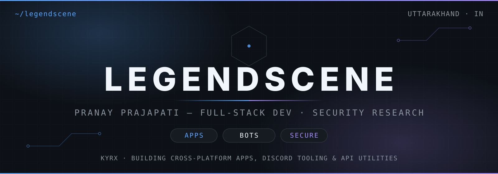
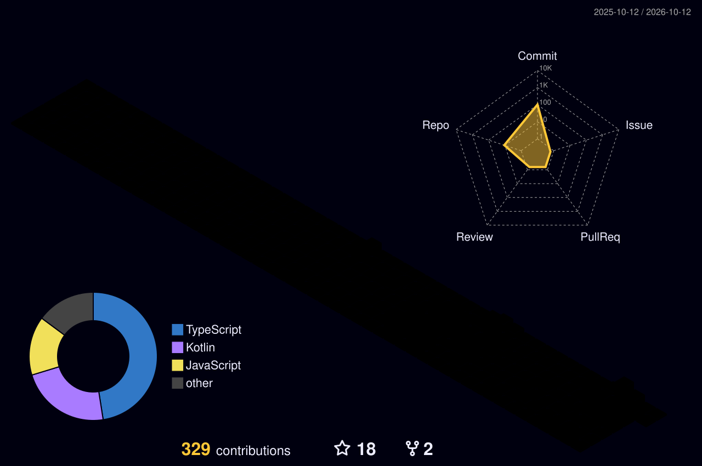

  

  

**Pranay Prajapati · @Legendscene · KYRX · Uttarakhand, India**

I build cross-platform apps, Discord tooling, and security-focused API utilities.
Currently working across TypeScript / JavaScript, Python, and Kotlin — with a growing focus on cybersecurity and system architecture.

## Focus

- Cross-platform apps — Web, Mobile & Desktop
- Discord bots, automation, and developer utilities
- APIs — rate limiting, monitoring, and hardening
- Security research and systems learning

## Stack

**Languages**

**App & API**

**Toolbox**

## Selected work

| Project | What it is |
|---|---|
| [darkcaptcha](https://github.com/Legendscene/darkcaptcha) | Captcha-solving package (JavaScript). |
| [My-Presence](https://github.com/Legendscene/My-Presence) | Turn your Android activity into a sleek Discord presence (Kotlin). |
| [Surge — Smart API Rate Limiting & Monitoring](https://github.com/Legendscene/Surge-Smart-API-Rate-Limiting-and-Monitoring) | Intelligent rate limiting, real-time monitoring, and DDoS protection for modern APIs (TypeScript). |
| [My-Presence-Desktop](https://github.com/Legendscene/My-Presence-Desktop) | Desktop client in the My-Presence series (TypeScript). |

More: [Discord-Bulk-Emoji-Downloader](https://github.com/Legendscene/Discord-Bulk-Emoji-Downloader) · [optinix](https://github.com/Legendscene/optinix) · [github-profiles-template](https://github.com/Legendscene/github-profiles-template)

## Stats

  
   
  

## Activity

  
   
  <picture>
    <source media="(prefers-color-scheme: dark)" srcset="https://raw.githubusercontent.com/Legendscene/Legendscene/output/github-contribution-grid-snake-dark.svg" />
    <source media="(prefers-color-scheme: light)" srcset="https://raw.githubusercontent.com/Legendscene/Legendscene/output/github-contribution-grid-snake.svg" />
    
  </picture>

## Connect

 

  

